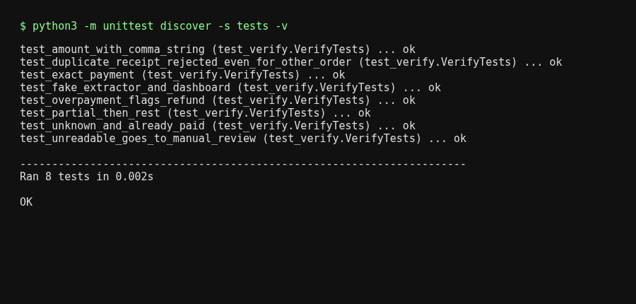

# PaySmart AI

نظام بيراجع إيصالات الدفع بـ InstaPay ومحافظ الموبايل تلقائيًا: العميل يبعت صورة الإيصال على بوت تليجرام، الذكاء الاصطناعي (Gemini Vision) يقرأ المبلغ ورقم العملية، والنظام يقرر: مقبول، جزئي، زيادة، مكرر، أو يحتاج مراجعة، وشاشة الكاشير تتحدث لوحدها.

مشروع نهائي لبرنامج AICR (Creativa). كتبه محمد خيري.

**عرض مباشر (ديمو واجهات):** https://paysmart-ai.pages.dev (الواجهات حقيقية، لكن الـ API هناك محاكاة، شوف قسم الحالة).

*English: a small Python project that checks InstaPay / wallet payment receipts. A customer sends a receipt photo to a Telegram bot, Gemini Vision extracts the amount and transaction ID, and the core logic accepts it, flags partial or over-payment, or rejects a reused receipt. A simple page shows order status for the cashier.*

## عرض سريع (Demo)



الصور من تشغيل الكود الحقيقي ببيانات تجريبية (مفيش إيصالات حقيقية):

- نتيجة الاختبارات والديمو: `docs/terminal.png` و `docs/demo-output.txt`
- شاشة الكاشير بعد معالجة 4 طلبات (مدفوع، مدفوع بزيادة، مراجعة يدوية): `docs/dashboard.png`

الديمو بيستخدم قراءة إيصال تجريبية (`FakeExtractor`)، فمش بيثبت دقة Gemini على إيصالات حقيقية.

## المشكلة

InstaPay مفيهوش API متاح للمتاجر الصغيرة، فالتاجر بيستلم التحويل على حسابه ويراجع كل سكرين شوت بإيده. ده بياخد وقت وقت الزحمة، وبيفتح باب لتكرار نفس الإيصال على أكتر من طلب.

## اللي المشروع بيعمله فعلًا

| الجزء | الملف | الحالة |
|---|---|---|
| منطق مراجعة الإيصال: مبلغ مطابق، دفع جزئي، زيادة، رقم عملية مكرر، طلب مش موجود، قراءة غير واضحة | `paysmart/verify.py` | مختبر (8 اختبارات) |
| منع التكرار: رقم العملية مفتاح فريد في قاعدة البيانات، حتى لو الإيصال اتبعت لطلب تاني | `paysmart/db.py` | مختبر |
| قراءة الإيصال بـ Gemini Vision وإرجاع JSON | `paysmart/extractor.py` | مكتوب، **محتاج مفتاح Gemini ومتجرّبش على إيصالات حقيقية** |
| بوت تليجرام (رابط `t.me/<bot>?start=ORD_XXXX` يحفظ رقم الطلب) | `paysmart/bot.py` | مكتوب، **محتاج توكن بوت ومتجرّبش على تليجرام فعليًا** |
| شاشة الكاشير (صفحة HTML بتتحدث كل 3 ثواني) | `paysmart/dashboard.py` | مختبرة محليًا |
| ديمو بدون إنترنت بيشغّل المنطق الحقيقي ببيانات تجريبية | `paysmart/demo.py` | شغال |

## التشغيل

بدون أي مفاتيح (اختبارات + ديمو):

```bash
python3 -m unittest discover -s tests -v
python3 -m paysmart.demo
```

مخرجات الديمو في `docs/demo-output.txt`.

تشغيل حقيقي (محتاج Python 3.9+ وبس، مفيش مكتبات خارجية):

```bash
cp .env.example .env        # حط التوكن والمفتاح بتوعك. الملف ده مش بيترفع على GitHub
export $(grep -v '^#' .env | xargs)
python3 -m paysmart.bot         # البوت
python3 -m paysmart.dashboard   # شاشة الكاشير على http://127.0.0.1:8080
```

الطلبات بتتضاف لقاعدة البيانات من متجرك (`paysmart.db.create_order`). ربط المتجر الإلكتروني نفسه مش جزء من الكود ده.

## هيكل المستودع

| المسار | المحتوى |
|---|---|
| `paysmart/`, `tests/` | نسخة Python: منطق المراجعة + قاعدة SQLite + 8 اختبارات |
| `node-app/` | نسخة Node.js/Express: سيرفر الطلبات، شاشة الكاشير، صفحات الويب الثلاث، خدمات Gemini وتليجرام |
| `node-app/public/` | الصفحات: المتجر، تأكيد الطلب، شاشة الكاشير (دي اللي منشورة على Cloudflare Pages) |
| `node-app/functions/` | Cloudflare Pages Function: **محاكاة** للـ API للديمو المستضاف فقط |
| `workflows/` | ملفا n8n (خط كامل: طلب، Google Sheets، تليجرام، Gemini، قواعد مالية، إشعار الكاشير) |
| `docs/` | صور تشغيل وديمو (`docs/screens/` لصور نسخة Node و n8n) |

## الحالة بصراحة (إيه اتجرب وإيه لأ)

| الجزء | الحالة |
|---|---|
| منطق المراجعة بـ Python + الاختبارات | اتجرب (8 اختبارات) |
| سيرفر Node.js وصفحاته | اتشغل محليًا على بورت 3000 وجُربت نقاط الـ API ببيانات تجريبية |
| تليجرام (Node و Python) | مكتوب. في النسخة المحلية اشتغل في **وضع محاكاة** بتوكن وهمي. ماتجرّبش على بوت حقيقي |
| Gemini Vision | مكتوب. اشتغل في **وضع محاكاة** بمفتاح وهمي. ماتجرّبش على إيصالات حقيقية |
| n8n | الملف اتفتح في محرر n8n محليًا (لقطة في `docs/screens/n8n_canvas.jpg`). المعرفات placeholders (`GOOGLE_SHEET_ID_HERE`, `YourStoreBot`) ومحتاج ضبط قبل التشغيل |
| الديمو على Cloudflare Pages | الواجهات حقيقية. الـ API محاكاة في الذاكرة بيرجع نتيجة قبول ثابتة ومش بيحلل صورة الإيصال ولا بيكلم تليجرام |

## تشغيل نسخة Node محليًا

```bash
cd node-app
cp .env.example .env     # املا التوكن والمفتاح بتوعك. الملف ده في .gitignore ومش بيترفع
npm install
node server.js           # http://localhost:3000  و /cashier.html
```

الأسرار (توكن البوت، مفتاح Gemini) بتتحط في `.env` بس، ومفيش أي منها في المستودع.

## حدود لازم تتقال بصراحة

- المشروع بيقرأ **صورة** الإيصال. مش بيتأكد من البنك إن التحويل وصل فعلًا (مفيش API). صورة متعدلة بتغير الأرقام ممكن تعدي لو رقم العملية جديد.
- منع التكرار بيعتمد على رقم العملية اللي Gemini يقراه. لو القراءة غلط أو الرقم مش ظاهر، الطلب بيروح لمراجعة يدوية.
- أرقام زي «ثانيتين» أو «100% منع تكرار» **أهداف تصميم مش نتايج مقاسة**. لسه ماتقاسش زمن ولا دقة القراءة على إيصالات حقيقية.
- لوحة المطبخ حاليًا بتعرض حالة الدفع. مراحل التحضير (`kitchen_stage`) موجودة في قاعدة البيانات لكن مفيش واجهة لتغييرها لسه.

## الخطوات الجاية

1. تجربة القراءة على عينة إيصالات حقيقية (بعد إخفاء البيانات) وقياس الدقة والزمن.
2. ربط متجر حقيقي بإنشاء الطلبات ورابط تليجرام.
3. واجهة لتغيير مراحل المطبخ، وتنبيه الكاشير في حالة الزيادة أو المراجعة.

## الترخيص

MIT
